<!-- Generated by `php artisan erd:generate` — do not edit. Regenerate after schema changes. -->

# Catalog

30 tables · FK edges: 31 · app-level edges: 5 · polymorphic: 4

> **Legend** — solid `--`: enforced database FK · dashed `..`: Eloquent relation without a DB FK.
> `PK` primary · `FK` foreign key (arrow shows target) · `UK` unique.

```mermaid
erDiagram
    catalog_attribute_group_translations {
        bigint_unsigned id PK
        bigint_unsigned attribute_group_id FK "→ catalog_attribute_groups"
        bigint_unsigned language_id
        varchar title
        timestamp created_at
        timestamp updated_at
    }
    catalog_attribute_groups {
        bigint_unsigned id PK
        smallint_unsigned position
        timestamp created_at
        timestamp updated_at
    }
    catalog_attribute_template_groups {
        bigint_unsigned template_id PK, FK "→ catalog_attribute_templates"
        bigint_unsigned group_id PK, FK "→ catalog_attribute_groups"
        smallint_unsigned position
    }
    catalog_attribute_templates {
        bigint_unsigned id PK
        varchar title
        text description
        tinyint is_active
        smallint_unsigned position
        timestamp created_at
        timestamp updated_at
    }
    catalog_attribute_translations {
        bigint_unsigned id PK
        bigint_unsigned attribute_id FK "→ catalog_attributes"
        bigint_unsigned language_id
        varchar title
        timestamp created_at
        timestamp updated_at
    }
    catalog_attribute_value_translations {
        bigint_unsigned id PK
        bigint_unsigned attribute_value_id FK "→ catalog_attribute_values"
        bigint_unsigned language_id
        varchar title
        timestamp created_at
        timestamp updated_at
    }
    catalog_attribute_values {
        bigint_unsigned id PK
        bigint_unsigned attribute_id FK "→ catalog_attributes"
        smallint_unsigned position
        timestamp created_at
        timestamp updated_at
    }
    catalog_attributes {
        bigint_unsigned id PK
        bigint_unsigned group_id FK "→ catalog_attribute_groups"
        varchar code UK
        enum data_type
        tinyint is_filterable
        smallint_unsigned position
        timestamp created_at
        timestamp updated_at
    }
    catalog_brand_translations {
        bigint_unsigned id PK
        bigint_unsigned brand_id FK "→ catalog_brands"
        bigint_unsigned language_id
        varchar title
        varchar slug
        varchar description
        timestamp created_at
        timestamp updated_at
    }
    catalog_brands {
        bigint_unsigned id PK
        smallint_unsigned position
        bigint_unsigned image_media_id
        varchar image_url
        timestamp created_at
        timestamp updated_at
    }
    catalog_categories {
        bigint_unsigned id PK
        bigint_unsigned parent_id
        smallint_unsigned position
        bigint_unsigned image_media_id
        varchar image_url
        timestamp created_at
        timestamp updated_at
    }
    catalog_category_attribute {
        bigint_unsigned category_id PK, FK "→ catalog_categories"
        bigint_unsigned attribute_id PK, FK "→ catalog_attributes"
        smallint_unsigned position
    }
    catalog_category_product {
        bigint_unsigned product_id PK, FK "→ catalog_products"
        bigint_unsigned category_id PK, FK "→ catalog_categories"
    }
    catalog_category_translations {
        bigint_unsigned id PK
        bigint_unsigned category_id FK "→ catalog_categories"
        bigint_unsigned language_id
        varchar title
        varchar slug
        varchar description
        timestamp created_at
        timestamp updated_at
    }
    catalog_featured_items {
        bigint_unsigned id PK
        varchar featuredable_type
        bigint_unsigned featuredable_id
        smallint_unsigned position
        timestamp created_at
        timestamp updated_at
    }
    catalog_images {
        bigint_unsigned id PK
        bigint_unsigned product_id FK "→ catalog_products"
        bigint_unsigned variant_id FK "→ catalog_variants"
        bigint_unsigned media_id
        enum collection
        varchar url
        tinyint_unsigned position
        timestamp created_at
        timestamp updated_at
    }
    catalog_imports {
        bigint_unsigned id PK
        bigint_unsigned user_id
        bigint_unsigned media_id
        varchar filename
        enum entity
        enum status
        enum strategy
        tinyint dry_run
        int_unsigned total_rows
        int_unsigned created_count
        int_unsigned updated_count
        int_unsigned skipped_count
        int_unsigned failed_count
        int_unsigned duration_ms
        json errors
        json summary
        timestamp created_at
        timestamp updated_at
    }
    catalog_option_translations {
        bigint_unsigned id PK
        bigint_unsigned option_id FK "→ catalog_options"
        bigint_unsigned language_id
        varchar title
        varchar slug
        timestamp created_at
        timestamp updated_at
    }
    catalog_option_value_translations {
        bigint_unsigned id PK
        bigint_unsigned option_value_id FK "→ catalog_option_values"
        bigint_unsigned language_id
        varchar title
        varchar slug
        timestamp created_at
        timestamp updated_at
    }
    catalog_option_values {
        bigint_unsigned id PK
        bigint_unsigned option_id FK "→ catalog_options"
        smallint_unsigned position
        timestamp created_at
        timestamp updated_at
    }
    catalog_options {
        bigint_unsigned id PK
        smallint_unsigned position
        timestamp created_at
        timestamp updated_at
    }
    catalog_product_attribute_values {
        bigint_unsigned id PK
        bigint_unsigned product_id FK "→ catalog_products"
        bigint_unsigned attribute_id FK "→ catalog_attributes"
        bigint_unsigned attribute_value_id FK "→ catalog_attribute_values"
        varchar text_value
        decimal number_value
        tinyint boolean_value
    }
    catalog_product_comment_reactions {
        bigint_unsigned id PK
        bigint_unsigned product_comment_id FK "→ catalog_product_comments"
        bigint_unsigned user_id
        enum reaction
        timestamp created_at
        timestamp updated_at
    }
    catalog_product_comments {
        bigint_unsigned id PK
        bigint_unsigned product_id FK "→ catalog_products"
        bigint_unsigned user_id
        bigint_unsigned parent_id FK "→ catalog_product_comments"
        text body
        tinyint_unsigned rating
        enum status
        timestamp created_at
        timestamp updated_at
    }
    catalog_product_seo_translations {
        bigint_unsigned id PK
        bigint_unsigned product_id FK "→ catalog_products"
        bigint_unsigned language_id
        varchar meta_title
        varchar meta_description
        varchar open_graph_title
        varchar open_graph_description
        timestamp created_at
        timestamp updated_at
    }
    catalog_product_shipping {
        bigint_unsigned id PK
        bigint_unsigned product_id FK "→ catalog_products"
        decimal weight
        enum weight_unit
        decimal package_length
        decimal package_width
        decimal package_height
        enum dimension_unit
        tinyint requires_shipping
        timestamp created_at
        timestamp updated_at
    }
    catalog_product_translations {
        bigint_unsigned id PK
        bigint_unsigned product_id FK "→ catalog_products"
        bigint_unsigned language_id
        varchar title
        varchar slug
        longtext content
        varchar description
        timestamp created_at
        timestamp updated_at
    }
    catalog_products {
        bigint_unsigned id PK
        enum type
        enum status
        tinyint is_published
        bigint_unsigned tax_class_id
        decimal rating_avg
        int_unsigned rating_count
        timestamp deleted_at
        timestamp created_at
        timestamp updated_at
        bigint_unsigned brand_id FK "→ catalog_brands"
    }
    catalog_variant_option_values {
        bigint_unsigned option_value_id FK "→ catalog_option_values"
        bigint_unsigned variant_id FK "→ catalog_variants"
    }
    catalog_variants {
        bigint_unsigned id PK
        bigint_unsigned product_id FK "→ catalog_products"
        varchar sku UK
        varchar barcode UK
        decimal price
        smallint_unsigned quantity
        decimal compare_price
        decimal cost_price
        tinyint is_default
        timestamp created_at
        timestamp updated_at
    }
    %% external tables:
    %% inventory_inventory_stocks (owned by Inventory)
    catalog_attribute_group_translations }o--|| catalog_attribute_groups : "attribute_group_id"
    catalog_attribute_template_groups }o--|| catalog_attribute_groups : "group_id"
    catalog_attribute_template_groups }o--|| catalog_attribute_templates : "template_id"
    catalog_attribute_translations }o--|| catalog_attributes : "attribute_id"
    catalog_attribute_value_translations }o--|| catalog_attribute_values : "attribute_value_id"
    catalog_attribute_values }o--|| catalog_attributes : "attribute_id"
    catalog_attributes }o--|| catalog_attribute_groups : "group_id"
    catalog_brand_translations }o--|| catalog_brands : "brand_id"
    catalog_category_attribute }o--|| catalog_attributes : "attribute_id"
    catalog_category_attribute }o--|| catalog_categories : "category_id"
    catalog_category_product }o--|| catalog_categories : "category_id"
    catalog_category_product }o--|| catalog_products : "product_id"
    catalog_category_translations }o--|| catalog_categories : "category_id"
    catalog_images }o--|| catalog_products : "product_id"
    catalog_images }o--o| catalog_variants : "variant_id"
    catalog_option_translations }o--|| catalog_options : "option_id"
    catalog_option_translations }o..|| catalog_products : "product_id"
    catalog_option_value_translations }o--|| catalog_option_values : "option_value_id"
    catalog_option_value_translations }o..|| catalog_products : "product_id"
    catalog_option_values }o--|| catalog_options : "option_id"
    catalog_option_values }o..|| catalog_products : "product_id"
    catalog_options }o..|| catalog_products : "product_id"
    catalog_product_attribute_values }o--o| catalog_attribute_values : "attribute_value_id"
    catalog_product_attribute_values }o--|| catalog_attributes : "attribute_id"
    catalog_product_attribute_values }o--|| catalog_products : "product_id"
    catalog_product_comment_reactions }o--|| catalog_product_comments : "product_comment_id"
    catalog_product_comments }o--o| catalog_product_comments : "parent_id"
    catalog_product_comments }o--|| catalog_products : "product_id"
    catalog_product_seo_translations }o--|| catalog_products : "product_id"
    catalog_product_shipping ||--o| catalog_products : "product_id"
    catalog_product_translations }o--|| catalog_products : "product_id"
    catalog_products }o--o| catalog_brands : "brand_id"
    catalog_variant_option_values }o--|| catalog_option_values : "option_value_id"
    catalog_variant_option_values }o..|| catalog_products : "variant_id"
    catalog_variant_option_values }o--|| catalog_variants : "variant_id"
    catalog_variants }o--|| catalog_products : "product_id"
    inventory_inventory_stocks ||..o| catalog_variants : "variant_id"
```

### Polymorphic relations

| Table | Columns | Possible targets |
|---|---|---|
| `catalog_featured_items` | `featuredable_type`, `featuredable_id` | brand (morph map) |
| `catalog_featured_items` | `featuredable_type`, `featuredable_id` | category (morph map) |
| `catalog_featured_items` | `featuredable_type`, `featuredable_id` | dynamic |
| `catalog_featured_items` | `featuredable_type`, `featuredable_id` | product (morph map) |

### Unresolved reference columns

Reference-looking columns with neither a DB FK nor an Eloquent relation — cross-module references resolved via gateways at runtime. Targets inferred from naming, **not verified**:

- `catalog_attribute_group_translations.language_id` → `core_languages`?
- `catalog_attribute_translations.language_id` → `core_languages`?
- `catalog_attribute_value_translations.language_id` → `core_languages`?
- `catalog_brand_translations.language_id` → `core_languages`?
- `catalog_brands.image_media_id`
- `catalog_categories.image_media_id`
- `catalog_categories.parent_id`
- `catalog_category_translations.language_id` → `core_languages`?
- `catalog_images.media_id`
- `catalog_imports.media_id`
- `catalog_imports.user_id` → `auth_users / user_users (ambiguous)`?
- `catalog_option_translations.language_id` → `core_languages`?
- `catalog_option_value_translations.language_id` → `core_languages`?
- `catalog_product_comment_reactions.user_id` → `auth_users / user_users (ambiguous)`?
- `catalog_product_comments.user_id` → `auth_users / user_users (ambiguous)`?
- `catalog_product_seo_translations.language_id` → `core_languages`?
- `catalog_product_translations.language_id` → `core_languages`?
- `catalog_products.tax_class_id` → `tax_classes`?
