<!-- Generated by `php artisan erd:generate` — do not edit. Regenerate after schema changes. -->

# Content

11 tables · FK edges: 9 · app-level edges: 0 · polymorphic: 2

> **Legend** — solid `--`: enforced database FK · dashed `..`: Eloquent relation without a DB FK.
> `PK` primary · `FK` foreign key (arrow shows target) · `UK` unique.

```mermaid
erDiagram
    content_featured_items {
        bigint_unsigned id PK
        varchar featuredable_type
        bigint_unsigned featuredable_id
        smallint_unsigned position
        timestamp created_at
        timestamp updated_at
    }
    content_page_translations {
        bigint_unsigned id PK
        bigint_unsigned page_id FK "→ content_pages"
        bigint_unsigned language_id
        varchar title
        varchar slug
        mediumtext content
        varchar description
        timestamp created_at
        timestamp updated_at
    }
    content_pages {
        bigint_unsigned id PK
        enum status
        timestamp created_at
        timestamp updated_at
    }
    content_post_categories {
        bigint_unsigned id PK
        bigint_unsigned parent_id
        smallint_unsigned position
        timestamp created_at
        timestamp updated_at
    }
    content_post_category_post {
        bigint_unsigned post_id PK, FK "→ content_posts"
        bigint_unsigned post_category_id PK, FK "→ content_post_categories"
    }
    content_post_category_translations {
        bigint_unsigned id PK
        bigint_unsigned post_category_id FK "→ content_post_categories"
        bigint_unsigned language_id
        varchar title
        varchar slug
        varchar description
        timestamp created_at
        timestamp updated_at
    }
    content_post_comments {
        bigint_unsigned id PK
        bigint_unsigned post_id FK "→ content_posts"
        bigint_unsigned user_id
        bigint_unsigned parent_id FK "→ content_post_comments"
        text body
        enum status
        timestamp created_at
        timestamp updated_at
    }
    content_post_product {
        bigint_unsigned post_id PK, FK "→ content_posts"
        bigint_unsigned product_id PK
    }
    content_post_seo_translations {
        bigint_unsigned id PK
        bigint_unsigned post_id FK "→ content_posts"
        bigint_unsigned language_id
        varchar meta_title
        varchar meta_description
        varchar open_graph_title
        varchar open_graph_description
        timestamp created_at
        timestamp updated_at
    }
    content_post_translations {
        bigint_unsigned id PK
        bigint_unsigned post_id FK "→ content_posts"
        bigint_unsigned language_id
        varchar title
        varchar slug
        longtext content
        varchar description
        timestamp created_at
        timestamp updated_at
    }
    content_posts {
        bigint_unsigned id PK
        enum status
        timestamp published_at
        timestamp created_at
        timestamp updated_at
        bigint_unsigned image_media_id
        varchar image_url
    }
    content_page_translations }o--|| content_pages : "page_id"
    content_post_category_post }o--|| content_post_categories : "post_category_id"
    content_post_category_post }o--|| content_posts : "post_id"
    content_post_category_translations }o--|| content_post_categories : "post_category_id"
    content_post_comments }o--o| content_post_comments : "parent_id"
    content_post_comments }o--|| content_posts : "post_id"
    content_post_product }o--|| content_posts : "post_id"
    content_post_seo_translations }o--|| content_posts : "post_id"
    content_post_translations }o--|| content_posts : "post_id"
```

## Polymorphic relations

| Table | Columns | Possible targets |
| --- | --- | --- |
| `content_featured_items` | `featuredable_type`, `featuredable_id` | dynamic |
| `content_featured_items` | `featuredable_type`, `featuredable_id` | post (morph map) |

## Unresolved reference columns

Reference-looking columns with neither a DB FK nor an Eloquent relation — cross-module references resolved via gateways at runtime. Targets inferred from naming, **not verified**:

- `content_page_translations.language_id` → `core_languages`?
- `content_post_categories.parent_id`
- `content_post_category_translations.language_id` → `core_languages`?
- `content_post_comments.user_id` → `auth_users / user_users (ambiguous)`?
- `content_post_seo_translations.language_id` → `core_languages`?
- `content_post_translations.language_id` → `core_languages`?
- `content_posts.image_media_id`
