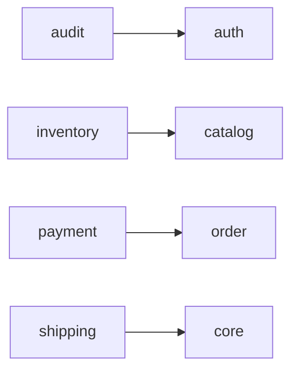

<!-- Generated by `php artisan erd:generate` — do not edit. Regenerate after schema changes. -->

# Database ERD

104 tables across 20 modules. Regenerate with `php artisan erd:generate`.

| Module | Tables | FK edges | App-level edges | Unresolved refs |
|---|---:|---:|---:|---:|
| [Audit](audit.md) | 1 | 0 | 1 | 1 |
| [Auth](auth.md) | 7 | 4 | 0 | 0 |
| [Cart](cart.md) | 2 | 1 | 0 | 2 |
| [Catalog](catalog.md) | 30 | 31 | 5 | 18 |
| [Contact](contact.md) | 2 | 0 | 0 | 0 |
| [Content](content.md) | 11 | 9 | 0 | 7 |
| [Core](core.md) | 4 | 0 | 0 | 1 |
| [Discount](discount.md) | 5 | 3 | 0 | 4 |
| [Inventory](inventory.md) | 1 | 0 | 1 | 0 |
| [Media](media.md) | 2 | 1 | 0 | 3 |
| [Menu](menu.md) | 4 | 3 | 2 | 2 |
| [Notification](notification.md) | 4 | 0 | 0 | 5 |
| [Order](order.md) | 4 | 3 | 0 | 9 |
| [Payment](payment.md) | 3 | 2 | 0 | 4 |
| [Setting](setting.md) | 2 | 1 | 0 | 1 |
| [Shipping](shipping.md) | 6 | 4 | 1 | 2 |
| [Support](support.md) | 2 | 0 | 1 | 2 |
| [Tax](tax.md) | 2 | 1 | 0 | 0 |
| [User](user.md) | 3 | 0 | 0 | 4 |
| [Other](other.md) | 9 | 0 | 0 | 2 |

## Module dependencies (cross-module references)

> **Legend** — solid `--`: enforced database FK · dashed `..`: Eloquent relation without a DB FK.
