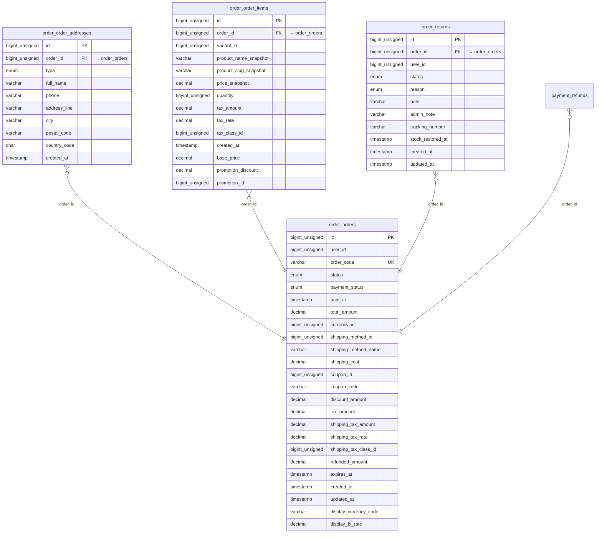

<!-- Generated by `php artisan erd:generate` — do not edit. Regenerate after schema changes. -->

# Order

4 tables · FK edges: 3 · app-level edges: 0 · polymorphic: 0

> **Legend** — solid `--`: enforced database FK · dashed `..`: Eloquent relation without a DB FK.
> `PK` primary · `FK` foreign key (arrow shows target) · `UK` unique.

### Unresolved reference columns

Reference-looking columns with neither a DB FK nor an Eloquent relation — cross-module references resolved via gateways at runtime. Targets inferred from naming, **not verified**:

- `order_order_items.promotion_id` → `discount_promotions`?
- `order_order_items.tax_class_id` → `tax_classes`?
- `order_order_items.variant_id` → `catalog_variants`?
- `order_orders.coupon_id` → `discount_coupons`?
- `order_orders.currency_id`
- `order_orders.shipping_method_id` → `shipping_methods`?
- `order_orders.shipping_tax_class_id`
- `order_orders.user_id` → `auth_users / user_users (ambiguous)`?
- `order_returns.user_id` → `auth_users / user_users (ambiguous)`?
