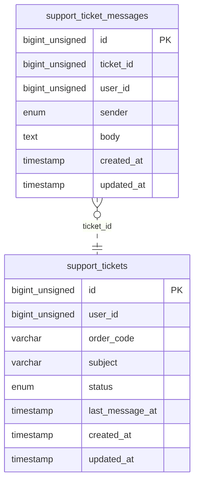

<!-- Generated by `php artisan erd:generate` — do not edit. Regenerate after schema changes. -->

# Support

2 tables · FK edges: 0 · app-level edges: 1 · polymorphic: 0

> **Legend** — solid `--`: enforced database FK · dashed `..`: Eloquent relation without a DB FK.
> `PK` primary · `FK` foreign key (arrow shows target) · `UK` unique.

### Unresolved reference columns

Reference-looking columns with neither a DB FK nor an Eloquent relation — cross-module references resolved via gateways at runtime. Targets inferred from naming, **not verified**:

- `support_ticket_messages.user_id` → `auth_users / user_users (ambiguous)`?
- `support_tickets.user_id` → `auth_users / user_users (ambiguous)`?
