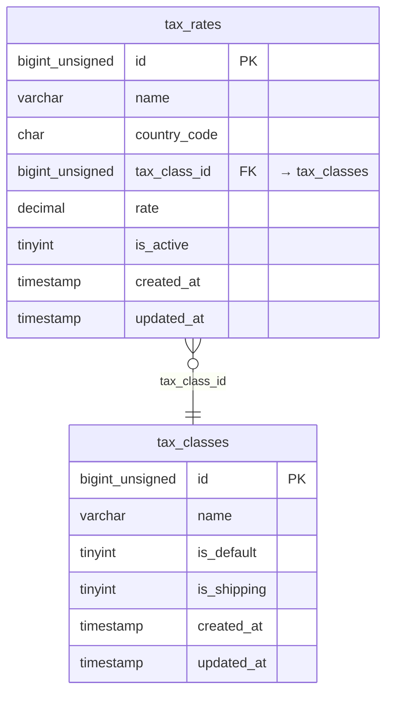

<!-- Generated by `php artisan erd:generate` — do not edit. Regenerate after schema changes. -->

# Tax

2 tables · FK edges: 1 · app-level edges: 0 · polymorphic: 0

> **Legend** — solid `--`: enforced database FK · dashed `..`: Eloquent relation without a DB FK.
> `PK` primary · `FK` foreign key (arrow shows target) · `UK` unique.

