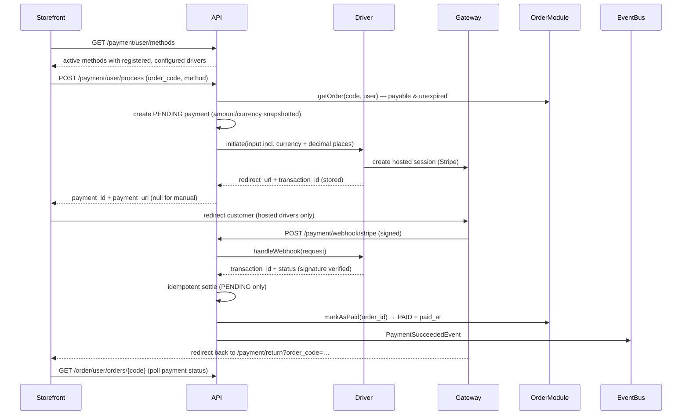

# Payment Flow (Sync by Default, Async-Capable)

Checkout and payment are two steps: checkout creates an UNPAID order
(expiring in 30 minutes), then a payment is started against its public
`order_code`.

## Drivers

Payment behavior is an open driver registry: the slug key in
`config('payment.drivers')` **is** the method's identity (no enum —
extensions merge their own entries in at boot), the value is a
`PaymentDriverInterface` implementation, and `PaymentDriverManager`
resolves it by string (`forName()`, also what the parameterized webhook
route uses) while exposing `isRegistered()` / `isConfigured()` /
`supportsRefund()`. Capabilities are declared next to the behavior, via
marker interfaces on the driver: `RefundableDriver` wires refund support,
`ConfigurableDriver::credentialKeys()` declares the config keys (relative
to `payment.{driver}.`) the full payment lifecycle needs — checkout
initiation **and** webhook verification.

Which methods customers see is state, not code: the `payment_methods`
table holds one row per method with `is_active` and `sort_order`, managed
by admins via `GET/PATCH /payment/admin/methods` (the list lazily creates
a disabled row for every registered driver, so a new gateway appears in
the admin without seeding; a method without a row counts as disabled, and
a row whose driver vanished is refused with `method_not_supported`).
A method is offerable only when its driver is registered **and**
configured (every declared credential key present — unregistered or
undeclaring drivers fail closed to false) **and** its row is active —
`GET /payment/user/methods` returns exactly that set, in the admin-set
order, and is the storefront's source of truth for the checkout picker.
`CreatePaymentAction` re-checks activation and rejects a disabled method
with `payment.process.method_inactive`, so a stale checkout page cannot
pay with a method an admin just turned off. Drivers also guard
themselves: a blank `payment.stripe.secret` (or webhook secret) throws
`payment.process.gateway_unconfigured` (HTTP 400) rather than surfacing an
SDK error as a 500.

| Method | Driver | Flow |
| --- | --- | --- |
| `manual` | `ManualPaymentDriver` | No hosted checkout; an admin settles it (`PATCH /admin/payments/{id}`). |
| `stripe` | `StripePaymentDriver` | Hosted Checkout redirect; settled by signed webhook. |
| `paypal` | `PaypalPaymentDriver` | Orders v2 hosted redirect; approved orders are captured on the webhook. |
| `adyen` | `AdyenPaymentDriver` | Pay by Link hosted redirect; settled by the HMAC-signed `AUTHORISATION` webhook. |
| `nowpayments` | `NowpaymentsPaymentDriver` | Crypto invoice hosted redirect; settled by the HMAC-signed `finished` IPN. |
| `mercadopago` | `MercadopagoPaymentDriver` | Checkout Pro hosted redirect; the shadow webhook triggers a payment fetch that settles on `approved`. |
| `checkoutcom` | `CheckoutcomPaymentDriver` | Payment Links hosted redirect; settled by the raw-body-signed `payment_captured` webhook. |
| `razorpay` | `RazorpayPaymentDriver` | Payment Links hosted redirect; settled by the raw-body-signed `payment_link.paid` webhook. |

## Sequence

The customer redirect is UX-only — settlement happens exclusively in the
webhook path, which is idempotent (replayed events for settled payments are
acked as no-ops).

## Stripe specifics

- Requires `STRIPE_SECRET` and `STRIPE_WEBHOOK_SECRET` in the backend `.env`
  (see `.env.example`); without the former the method is hidden from
  `/payment/user/methods`, and direct calls fail with
  `payment.process.gateway_unconfigured`.
- `initiate` creates a Checkout Session (`mode=payment`, single `price_data`
  line item in minor units from the order currency's `decimal_places`,
  `metadata.payment_id/order_id`, `{order_code}`-templated success/cancel
  URLs). The session id (`cs_...`) is stored as `transaction_id`.
- `handleWebhook` verifies `Stripe-Signature` (HMAC over the raw body) and
  maps: `checkout.session.completed` with `payment_status=paid` and
  `async_payment_succeeded` → success; `async_payment_failed`/`expired` →
  failed; anything else → `payment.webhook.invalid`. A completed-but-unpaid
  session (deferred payment methods) is rejected so the payment stays
  PENDING until its terminal event.
- SDK access is wrapped in `StripeCheckout` so tests mock one class instead
  of the SDK's fluent service chain.

## PayPal specifics

- Requires `PAYPAL_CLIENT_ID` and `PAYPAL_CLIENT_SECRET` (plus
  `PAYPAL_MODE` — `sandbox` by default — and `PAYPAL_WEBHOOK_ID`) in the
  backend `.env` (see `.env.example`); without the credential pair the
  method is hidden from `/payment/user/methods`, and direct calls fail
  with `payment.process.gateway_unconfigured`.
- REST access is wrapped in the SDK-less `PaypalClient` (PayPal's PHP
  SDKs are deprecated): OAuth2 client-credentials token with cache on
  top of the Orders v2 API, so tests mock one class. PayPal order ids
  (`5O190…`) are alphanumeric — `payments.transaction_id` is a string.
- `initiate` creates an order (`intent=CAPTURE`, single purchase unit
  with `reference_id` = order code, `custom_id` = payment id, and a
  decimal-string `amount.value` built from the order currency's
  `decimal_places`; `{order_code}`-templated return/cancel URLs). The
  order id is stored as `transaction_id`, and the customer is sent to
  the response's `approve` link.
- `handleWebhook` first verifies the delivery through PayPal's
  `verify-webhook-signature` API (certificate-based over the `PAYPAL-*`
  transmission headers — unlike Stripe's HMAC there is no local check)
  and rejects anything the API does not confirm. Point the webhook at
  `POST /api/v1/payment/webhook/paypal` for `CHECKOUT.ORDER.APPROVED`,
  `PAYMENT.CAPTURE.COMPLETED`, `PAYMENT.CAPTURE.DENIED` and
  `CHECKOUT.PAYMENT-APPROVAL.REVERSED`.
- Redirect flows never auto-capture, so `CHECKOUT.ORDER.APPROVED` drives
  the capture: COMPLETED → success, DENIED/DECLINED → failed. The other
  terminal events map directly (capture events carry the stored order id
  at `resource.supplementary_data.related_ids.order_id`). PayPal retries
  non-2xx deliveries up to 25 times over 3 days, which is the guaranteed
  trigger: unexpected capture failures rethrow as 5xx so PayPal retries
  the whole webhook, while a replayed approval after settlement is acked
  via PayPal's `ORDER_ALREADY_CAPTURED` 422 instead of erroring until the
  retry cap.
- Local dev note: PayPal has no `stripe listen` equivalent — expose the
  backend through a tunnel (ngrok/cloudflared) and register that URL in
  the developer dashboard, or use the webhook simulator.

## Adyen specifics

- Requires `ADYEN_API_KEY` and `ADYEN_MERCHANT_ACCOUNT` (plus
  `ADYEN_ENV` — `test` by default — `ADYEN_HMAC_KEY` and
  `ADYEN_RETURN_URL`) in the backend `.env` (see `.env.example`); without
  the credential pair the method is hidden from `/payment/user/methods`,
  and direct calls fail with `payment.process.gateway_unconfigured`.
- Automatic-capture merchant accounts only: on a manual-capture account
  an authorised payment is not captured money and this driver would
  settle orders prematurely. Configure the account for auto capture or
  leave the method disabled.
- REST access is wrapped in the SDK-less `AdyenCheckout` (Checkout API
  v69, `x-api-key` auth). `initiate` creates a Payment Link with
  `reference` = payment id, an integer minor-units `amount`, and a
  `{order_code}`-templated `returnUrl`; the link `url` is the redirect.
  Adyen webhooks never carry the link id — the `AUTHORISATION`
  notification matches back via `merchantReference` — so the
  merchant-chosen reference (our payment id, not a gateway id) is what
  doubles as the stored `transaction_id`; the pspReference arriving on
  that notification is persisted as `gateway_transaction_id`, because
  the refund API keys on it. The link id is not persisted; find it in
  the Customer Area by merchantReference.
- `handleWebhook` verifies the standard-webhook HMAC locally (canonical
  string `pspReference:originalReference:merchantAccountCode:
  merchantReference:success`, `\` and `:` escaped, key base64-decoded —
  no API call, unlike PayPal) and maps `AUTHORISATION` success →
  success, failure → failed, and the refund lifecycle (`REFUND`,
  `REFUND_FAILED`, `REFUNDED_REVERSED`) to the refund ledger. Subscribe
  the webhook to the standard events at
  `POST /api/v1/payment/webhook/adyen` and ack with 200. Acceptance
  gate: verify per event against sandbox payloads that the refund's
  correlation field is echoed (`merchantReference` = the refund
  request's `reference`) — a reversal never associates with the wrong
  refund; the fallback key is the stored gateway refund id.
- **Refunds:** `refund` calls `POST /payments/{psp}/refunds` with the
  ledger uuid as both `reference` (echoed back as the webhook's
  `merchantReference`) and `Idempotency-Key`, and integer minor units.
  A 2xx means accepted, not completed: the ledger row moves to
  `processing` and stays reserved until the `REFUND` webhook confirms
  (success) or rejects (`REFUND_FAILED` → failed; on an already
  finalized refund → the reversal path restores the accounting;
  `REFUNDED_REVERSED` reverses a completed refund in either webhook
  order — from a pre-terminal row no accounting was ever applied, from
  a `success` row the order's refunded total is recomputed from the
  ledger's success-only rows). A refund on a payment without a
  persisted pspReference (settled before the column shipped) refuses
  explicitly with `payment.refund.not_supported` — refund it in the
  Customer Area.
- Single-item deliveries only: `WebhookResult` settles exactly one
  payment per request, so multi-item batches are rejected rather than
  half-processed — an architectural boundary of the driver contract, not
  input validation; do not "fix" it into a loop. A rejected batch is
  retried by Adyen (increasing intervals, no published count) and stays
  manually resendable in the Customer Area for 14 days.
- Local dev note: like PayPal there is no CLI forwarder — tunnel the
  backend (ngrok/cloudflared) and register the URL, or use the Customer
  Area webhook simulator.

## NowPayments specifics

- Requires `NOWPAYMENTS_API_KEY` and `NOWPAYMENTS_IPN_SECRET` (plus
  `NOWPAYMENTS_ENV` — `sandbox` by default — and the return/callback
  URLs) in the backend `.env` (see `.env.example`); without the pair the
  method is hidden from `/payment/user/methods`, and direct calls fail
  with `payment.process.gateway_unconfigured`. Settlement needs the IPN
  secret, so an API key alone never counts as configured.
- REST access is wrapped in the SDK-less `NowpaymentsClient` (invoice
  API, `x-api-key` auth). `initiate` creates an invoice (`order_id` =
  payment id — the echoed reference every IPN carries back, which is why
  it doubles as the stored `transaction_id` — a decimal `price_amount`
  in the order currency, and `{order_code}`-templated success/cancel
  URLs; the crypto amount is derived on NowPayments' side). The invoice
  id and payment id are not persisted; find them in the NowPayments
  cabinet by order reference.
- `handleWebhook` verifies the `x-nowpayments-sig` header locally:
  HMAC-SHA512 (hex) over the IPN body re-serialized with keys sorted
  alphabetically (recursively) and **without** escaping slashes or
  unicode, to match NowPayments' serializer. Only `finished` settles —
  the state where funds have reached the account wallet; `confirmed`
  (on-chain only) deliberately does not. `failed`/`expired` → failed.
  Crypto payments crawl through `waiting`/`confirming`/`sending`/
  `partially_paid` for minutes to hours; non-terminal IPNs are rejected
  so the payment stays PENDING until the terminal IPN arrives (same
  pattern as Stripe's deferred payment methods).
- The IPN callback is passed per invoice when
  `NOWPAYMENTS_IPN_CALLBACK_URL` is set (point it at
  `POST /api/v1/payment/webhook/nowpayments`); when empty the
  account-level setting in the NowPayments cabinet applies.
- Local dev note: same as PayPal/Adyen — tunnel the backend and
  register the URL, or trigger test IPNs from the cabinet.

## Mercado Pago specifics

- Requires `MERCADOPAGO_ACCESS_TOKEN` and `MERCADOPAGO_WEBHOOK_SECRET`
  (plus `MERCADOPAGO_SANDBOX` — `true` by default, redirecting via
  `sandbox_init_point` — and the back/notification URLs) in the backend
  `.env` (see `.env.example`); without the pair the method is hidden
  from `/payment/user/methods`, and direct calls fail with
  `payment.process.gateway_unconfigured`. The webhook secret key is
  configured separately in the developer dashboard — it is not the
  access token.
- REST access is wrapped in the SDK-less `MercadopagoClient`
  (`https://api.mercadopago.com`; the token decides test vs production).
  `initiate` creates a Checkout Pro preference (`external_reference` =
  payment id — the echoed reference the payment resource carries back,
  which is why it doubles as the stored `transaction_id`; a decimal
  `unit_price` line item; `{order_code}`-templated success/pending/
  failure `back_urls`; optional per-preference `notification_url`).
  Mercado Pago acquires in the account's country currency (BRL/ARS/MXN/
  …) — an order in another currency fails at preference creation and
  the payment stays PENDING by design.
- Notifications are **shadows**: the delivery only says which payment
  changed (`data.id`; the older style sends it as a `data.id` query
  parameter, which arrives as `data_id` because dots in query keys are
  mangled to underscores). `handleWebhook` verifies the `x-signature`
  header locally (manifest `id:{data.id};request-id:{x-request-id};
  ts:{ts};`, hex HMAC-SHA256 with the webhook secret) and then fetches
  `GET /v1/payments/{id}` for the outcome — the same
  API-call-in-the-webhook shape as PayPal's capture. Fetch failures
  bubble so Mercado Pago retries the delivery.
- Only `approved` settles (money in the account); `rejected`/`cancelled`
  → failed. Pix vouchers and Boleto slips sit in `pending`/`in_process`
  for hours — non-terminal statuses are rejected so the payment stays
  PENDING until the terminal notification (the deferred-payment pattern
  shared with Stripe/NowPayments). The MP payment id (`payment->id`) is
  persisted as `gateway_transaction_id` on every fetch — the refund API
  keys on it.
- **Refunds:** `refund` calls `POST /v1/payments/{mp_id}/refunds` with
  the **mandatory** `X-Idempotency-Key` (the ledger uuid — since 2024-01
  MP rejects refunds without it) and the explicit decimal amount. The
  explicit amount is always sent: omitting it asks MP to refund the
  payment's ORIGINAL total, which fails once a partial refund exists.
  An `approved` refund response is definitive (sync, like Stripe);
  anything else moves the ledger row to `processing`. There is no
  merchant-reference echo — reconciliation correlates through the
  gateway refund id: a `refunded`/`partially_refunded` notification
  re-announces every definitive `refunds[]` entry on the resource, and
  the ledger's transition guards make re-announced entries no-ops. A
  refund on a payment without a persisted MP id (settled before the
  column shipped) refuses explicitly with
  `payment.refund.not_supported` — refund it in the MP dashboard.
  Acceptance gate: verify the terminal refund-status value and the
  `refunds[]` entry shape against sandbox responses.
- Local dev note: same as the others — tunnel the backend and register
  the URL in the dashboard webhook config, or use the sandbox test
  cards.

## Checkout.com specifics

- Requires `CHECKOUTCOM_SECRET_KEY` (API key, `sk_…`) and
  `CHECKOUTCOM_WEBHOOK_SECRET` (plus `CHECKOUTCOM_ENV` — `sandbox` by
  default — and `CHECKOUTCOM_RETURN_URL`) in the backend `.env` (see
  `.env.example`); without the pair the method is hidden from
  `/payment/user/methods`, and direct calls fail with
  `payment.process.gateway_unconfigured`. The webhook signing secret is
  a **separate secret** shown on the webhook endpoint's page in the Hub —
  it is not the API key, and mixing them up is the most common
  verification failure.
- REST access is wrapped in the SDK-less `CheckoutcomClient`
  (`Authorization` header carries the raw key, no Bearer prefix).
  `initiate` creates a Payment Link (`reference` = payment id — echoed
  back by every event at `data.reference`, which is why it doubles as
  the stored `transaction_id`; integer minor-units `amount`; a
  `{order_code}`-templated `return_url`). The hosted URL is read from
  the response `_links` map (`payment-link` relation); its absence fails
  loudly. The `pay_…` id arriving on `payment_captured` (`data.id`) is
  persisted as `gateway_transaction_id` — the refund API keys on it. The
  link id is not persisted; find it in the Hub by reference.
- `handleWebhook` verifies `cko-signature` — HMAC-SHA256 over the
  **exact raw request bytes** (hex or base64 encoded, both accepted) —
  locally, like Stripe's raw-body HMAC. Hashing a re-serialized payload
  instead of the delivered bytes is Checkout.com's most documented
  verification pitfall, which is why the driver verifies before decoding.
- Automatic-capture accounts only: `payment_captured` is the sole
  settling event — `payment_approved` means authorised-but-uncaptured
  and must not settle the order (same constraint as Adyen).
  `payment_declined`/`payment_capture_declined`/`payment_canceled`/
  `payment_expired` → failed; everything else stays PENDING until the
  terminal event (the deferred-payment pattern). Subscribe the webhook
  to exactly that event set **plus the refund events** at
  `POST /api/v1/payment/webhook/checkoutcom`.
- **Refunds:** `refund` calls `POST /payments/{pay_…}/refunds` with the
  ledger uuid as both `reference` (echoed back on the refund events) and
  `Cko-Idempotency-Key`, and integer minor units. A 2xx means accepted,
  not completed: the ledger row moves to `processing` and stays reserved
  until `payment_refunded` (success) or `payment_refund_declined`
  (failure; on an already finalized refund → the reversal path restores
  the accounting) confirms. A refund on a payment without a persisted
  `pay_` id (settled before the column shipped) refuses explicitly with
  `payment.refund.not_supported` — refund it in the Hub. Acceptance
  gate: verify the refund events' payload fields (`data.reference`,
  `data.action_id`, payment association) against sandbox deliveries.
- Local dev note: same as the others — tunnel the backend and register
  the URL as the webhook endpoint in the Hub sandbox.

## Razorpay specifics

- Requires `RAZORPAY_KEY_ID`, `RAZORPAY_KEY_SECRET` and
  `RAZORPAY_WEBHOOK_SECRET` (plus `RAZORPAY_RETURN_URL`) in the backend
  `.env` (see `.env.example`); the method is hidden from
  `/payment/user/methods` until all three exist — a link can be created
  with just the key pair, but without the webhook secret nothing can
  ever settle, which is worse than failing. The key pair itself decides
  test vs production (`rzp_test_…` / `rzp_live_…`); the API base URL is
  global.
- REST access is wrapped in the SDK-less `RazorpayClient` (Basic auth
  with the key pair). `initiate` creates a Payment Link
  (`reference_id` = payment id — echoed back on the webhook's
  `payment_link.entity`, which is why it doubles as the stored
  `transaction_id`; integer minor-units `amount` in paise; a
  `{order_code}`-templated `callback_url` return page). The `short_url`
  is the redirect; its absence fails loudly. The captured `pay_…` id
  arriving on `payment_link.paid` (`payload.payment.entity.id`) is
  persisted as `gateway_transaction_id` — the refund API keys on it. The
  `plink_…` id is not persisted; find it in the dashboard by reference.
- `handleWebhook` verifies `x-razorpay-signature` — hex HMAC-SHA256 over
  the **exact raw request bytes** with the dashboard webhook secret —
  locally before decoding (re-serialization breaks verification, the
  same discipline as Stripe/Checkout.com).
- Only the link-level events are terminal: `payment_link.paid` → success
  (the amount is fully paid) and `payment_link.cancelled` → failed.
  Failed payment attempts (`payment.failed`) leave the link payable and
  the payment PENDING until a terminal event (the deferred-payment
  pattern). Subscribe the webhook to `payment_link.paid`,
  `payment_link.cancelled` **and the refund events** at
  `POST /api/v1/payment/webhook/razorpay` — refund events must be
  enabled explicitly in the dashboard webhook config, and delivery is
  unordered: a `refund.processed` may arrive after a create-call timeout
  and resolve the row the timeout left in `reconciliation_required`.
- **Refunds:** `refund` calls `POST /v1/payments/{pay_…}/refund` with
  paise, the ledger uuid as `X-Refund-Idempotency` (Razorpay's
  refund-specific idempotency header) and in the refund's `notes` —
  echoed back on the refund entity, so `refund.processed` /
  `refund.failed` correlate through it (fallback: the refund's own id).
  A `processed` response is definitive (instant refunds); a `pending`
  response moves the ledger row to `processing` until the webhook
  confirms. A refund on a payment without a persisted `pay_` id
  (settled before the column shipped) refuses explicitly with
  `payment.refund.not_supported` — a link with several captured
  payments is never refunded arbitrarily; refund it in the dashboard.
- Local dev note: same as the others — tunnel the backend and register
  the URL under Settings → Webhooks in the dashboard.

## Adding a payment driver

1. Implement `PaymentDriverInterface` (`initiate` + `handleWebhook`) under
   `Modules/Payment/app/Gateways/Drivers/`; verify the webhook signature
   inside `handleWebhook` and return the stored `transaction_id`.
2. Declare its capabilities on the driver itself: implement
   `ConfigurableDriver::credentialKeys()` (the `payment.{driver}.` keys its
   full lifecycle needs — it stays hidden from checkout until they exist;
   throw `gatewayUnconfigured()` inside the driver as the backstop) and
   `RefundableDriver` when `refund()` is wired.
3. Register the slug → class mapping in
   `Modules/Payment/config/payment.php` plus a config block for its
   env-driven credentials. No manager edit, ever — `isConfigured()` reads
   the driver's own declaration.
4. Point the gateway's webhook at `POST /api/v1/payment/webhook/{driver}` —
   `HandleWebhookAction` handles matching, idempotent settling, order
   `markAsPaid` and events generically.
5. Activate it: the new method appears in `GET /payment/admin/methods`
   (disabled) the first time an admin opens the page; flipping it active
   and ordering it there is all it takes — no seeding, no storefront
   deploy.
6. Storefront labels are optional: `ApiPaymentMethod` is an open type and
   checkout falls back to the raw slug, so add entries under
   `payment.methods.*` in `messages/{en,fa}/checkout/checkout.json` only
   for built-ins worth naming.
7. Cover the driver with unit tests (signature + event mapping) mirroring
   `StripePaymentDriverTest`.

Adyen was implemented following the same recipe — note that matching runs
on the webhook's `merchantReference` (see above), not its `pspReference`
as this note originally assumed. A Drop-in/Components integration would
additionally need return-handling on the driver contract.
